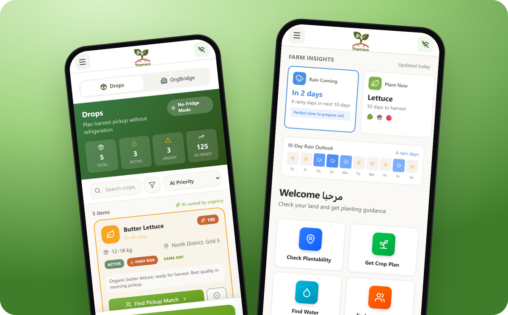
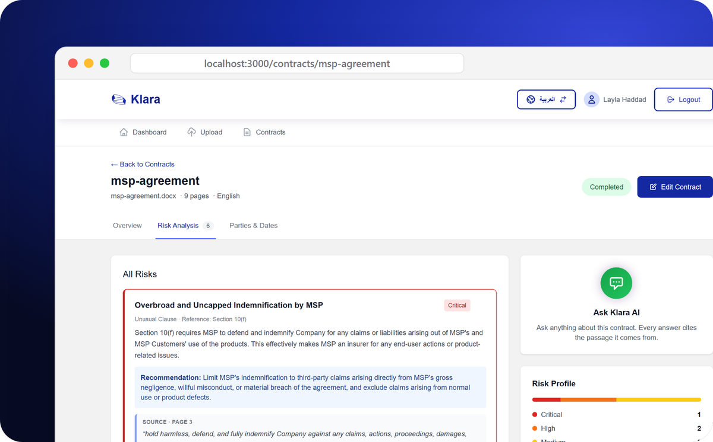
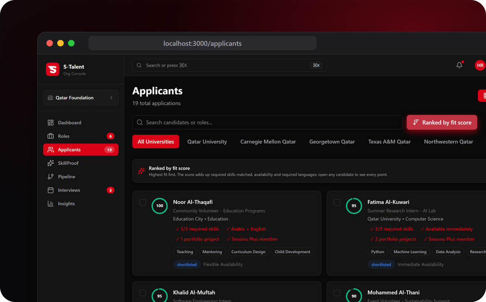

<picture>
  <source media="(prefers-color-scheme: dark)" srcset="./assets/banner-dark.svg">
  <source media="(prefers-color-scheme: light)" srcset="./assets/banner-light.svg">
  
</picture>

  <a href="https://www.vora.qa"><b>vora.qa</b></a>
  &nbsp;·&nbsp;
  <a href="https://www.linkedin.com/in/anas-rustom/">LinkedIn</a>
  &nbsp;·&nbsp;
  <a href="https://www.anasrustom.com">anasrustom.com</a>
  &nbsp;·&nbsp;
  <a href="mailto:anas@vora.qa">anas@vora.qa</a>

 

### Two billion air conditioners hold whatever setpoint someone picked.

They have no idea how the room behaves or what the weather will do, so they overcool. In Qatar and across the Gulf, cooling is about 70% of electricity demand, and the person paying the bill never sees the waste.

Those ACs don't need replacing. They need a brain.

**That's what I'm building at [Vora](https://www.vora.qa).** A small device and app that make the AC you already own intelligent, with no rewiring. Vora learns how your room and your AC behave, reads the weather forecast, plans six hours ahead, and adjusts the AC automatically. It also learns what healthy cooling looks like for each unit, and flags one whose cooling keeps getting worse so it can be inspected.

- **Startup World Cup 2026, Qatar regional winner.** Qualified for the Grand Finale in San Francisco, November 2026.
- **In the field.** Live pilot in a Doha clinic. Paid beta with ten homes committed: the first is live and paying, the other nine roll out in stages. Eight signed non-binding letters of intent from businesses.
- **Recognised** with an innovation award from Qatar's Ministry of Environment and Climate Change, 2nd place at [Al-Fikra 2026](https://www.qatar-tribune.com/article/233471/nation/qu-concludes-al-fikra-entrepreneurship-competition-for-higher-education-2026), 1st of 500+ participants at the Qatar Innovation Program 2025, and top 90 of 18,000+ teams in the Hult Prize Digital Incubator 2026. Incubated at QSTP. Featured in [Gulf Times](https://www.gulf-times.com/article/731251/qatar/qatar-based-startup-using-ai-to-make-air-conditioners-smarter) and by [QSTP](https://qstp.qa/blog/the-energy-we-waste-how-vora-is-rethinking-cooling/).
- **Built in-house, end to end:** ESP32 firmware and infrared control, cloud, mobile app, operator dashboard, and a physics-based optimizer that plans ahead (model predictive control).
- **With** co-founder Mazen Assayed (product) and Dr. Abdelkader Messlem (optimization), advised by Dr. Saud Abdul Ghani, lead cooling architect for Qatar's 2022 World Cup stadiums.

 

### Three hackathons. Three working prototypes.

Each one built in days, for someone else's hard problem.

<table>
  <tr>
    <td width="46%" valign="middle">
      
    </td>
    <td width="54%" valign="middle">
      <h3><a href="https://github.com/elansarii/thamara">Thamara</a></h3>
      <b>Built for farmers in Gaza restarting food production without internet.</b> 
      An offline-first app that checks whether damaged land can be planted, plans crops for salty soil and scarce water, finds water points, and coordinates seeds, tools and labour. Once a screen has loaded, it keeps working in airplane mode.  
      <b>3rd place, LifeLines Hackathon 2026</b> at Carnegie Mellon University in Qatar · QAR 9,000 · with <a href="https://github.com/elansarii">Mohamed Elansari</a> · <a href="https://www.youtube.com/watch?v=SN8vezWh0Tw">demo video</a>
    </td>
  </tr>
  <tr>
    <td width="46%" valign="middle">
      
    </td>
    <td width="54%" valign="middle">
      <h3><a href="https://github.com/anasrustom/Klara">Klara</a></h3>
      <b>Contract review that cites its sources, in Arabic and English.</b> 
      Upload a contract and Klara pulls out the parties, dates, money terms and risks, then points to the exact passage behind each one. Grounded retrieval plus Google Gemini, with a full right-to-left Arabic interface.  
      <b>Built in one weekend at the AIX Hackathon 2025</b> with <a href="https://github.com/mohamed-ali-ai">Mohamed Ali</a>, Mahmoud Ali and Abdulrahman Abushahba · FastAPI, FAISS, multilingual embeddings, Next.js
    </td>
  </tr>
  <tr>
    <td width="46%" valign="middle">
      
    </td>
    <td width="54%" valign="middle">
      <h3><a href="https://github.com/anasrustom/S-Talent">S-Talent</a></h3>
      <b>Hire interns on proof, not CVs.</b> 
      A hiring console that ranks early-career applicants with a score you can read line by line, and lets candidates with no experience prove a skill with a short practical task.  
      <b>Built overnight at the Snoonu Hackathon 2026</b> · Next.js 16, React 19, TypeScript
    </td>
  </tr>
</table>

 

### Where I learned to build

- **PwC, Emerging Technology Lab.** Built [Biometric Intelligence](https://biometric-intelligence-fe.etlabs.me/), which turns overnight Fitbit data into a daily readiness score, deployed live at PwC Middle East; and [GlassBox](https://glassbox-fe.etlabs.me/), which writes adversarial attacks against an AI system, runs them, and prints an EU AI Act compliance passport.
- **Siemens, Smart Infrastructure.** Ran the pilot of Siemens energy software across Msheireb Properties sites, wiring live meter data over MQTT, Modbus and BACnet.
- **QCRI.** Co-author on three submitted research papers; built an autism risk index from eye-tracking data with the Qatar Biomedical Research Institute.
- **Qatar University.** Computer Science with Honors, GPA 3.84. Co-founded the ACM student chapter and grew it from zero to 400+ members, as vice-president and then president. Two-time ACPC qualifier.

 

  Talking to building operators, installers and investors in Gulf cooling. The fastest way to reach me is <a href="mailto:anas@vora.qa">anas@vora.qa</a>.

