<picture>
  <source media="(prefers-color-scheme: dark)" srcset="./assets/banner-dark.svg">
  <source media="(prefers-color-scheme: light)" srcset="./assets/banner-light.svg">
  
</picture>

  <a href="https://www.vora.qa"><b>vora.qa</b></a>
  &nbsp;·&nbsp;
  <a href="https://www.linkedin.com/in/anas-rustom/">LinkedIn</a>
  &nbsp;·&nbsp;
  <a href="https://www.anasrustom.com">anasrustom.com</a>
  &nbsp;·&nbsp;
  <a href="mailto:anas@vora.qa">anas@vora.qa</a>

 

### Two billion air conditioners hold whatever setpoint someone picked.

So they overcool. In Qatar and across the Gulf, cooling is about 70% of electricity demand.

Those ACs don't need replacing. They need a brain.

**That's [Vora](https://www.vora.qa).** A small device and app that make the AC you already own intelligent: it plans six hours ahead and keeps the room comfortable on less energy.

- **Startup World Cup 2026, Qatar regional winner.** Qualified for the Grand Finale in San Francisco.
- **Recognised** by Qatar's Ministry of Environment and Climate Change, Al-Fikra 2026 (2nd), the Qatar Innovation Program (1st) and the Hult Prize (top 90 of 18,000+). Featured in [Gulf Times](https://www.gulf-times.com/article/731251/qatar/qatar-based-startup-using-ai-to-make-air-conditioners-smarter).

 

### Three hackathons. Three working prototypes.

<a href="https://github.com/elansarii/thamara">
  <picture>
    <source media="(prefers-color-scheme: dark)" srcset="./assets/thamara-dark.svg">
    <source media="(prefers-color-scheme: light)" srcset="./assets/thamara-light.svg">
    
  </picture>
</a>

For farmers restarting food production on damaged land, with no internet · <b>3rd place, LifeLines Hackathon 2026</b> · with <a href="https://github.com/elansarii">Mohamed Elansari</a> · <a href="https://www.youtube.com/watch?v=SN8vezWh0Tw">demo video</a>

<a href="https://github.com/anasrustom/Klara">
  <picture>
    <source media="(prefers-color-scheme: dark)" srcset="./assets/klara-dark.svg">
    <source media="(prefers-color-scheme: light)" srcset="./assets/klara-light.svg">
    
  </picture>
</a>

Every risk in a contract, linked to the clause it came from · <b>AIX Hackathon 2025</b> · with <a href="https://github.com/mohamed-ali-ai">Mohamed Ali</a>, Mahmoud Ali and Abdulrahman Abushahba

<a href="https://github.com/anasrustom/S-Talent">
  <picture>
    <source media="(prefers-color-scheme: dark)" srcset="./assets/s-talent-dark.svg">
    <source media="(prefers-color-scheme: light)" srcset="./assets/s-talent-light.svg">
    
  </picture>
</a>

A fit score you can read line by line, plus practical skill tasks · <b>Snoonu Hackathon 2026</b>

 

### Where I learned to build

- **PwC, Emerging Technology Lab.** Built [Biometric Intelligence](https://biometric-intelligence-fe.etlabs.me/) and [GlassBox](https://glassbox-fe.etlabs.me/), both live.
- **Siemens, Smart Infrastructure.** Ran an energy software pilot across Msheireb Properties sites.
- **QCRI.** Co-author on three submitted research papers.
- **Qatar University.** Computer Science with Honors, GPA 3.84. Co-founded the ACM chapter and grew it to 400+ members.

 

<picture>
  <source media="(prefers-color-scheme: dark)" srcset="https://github-profile-summary-cards.vercel.app/api/cards/profile-details?username=anasrustom&theme=github_dark">
  <source media="(prefers-color-scheme: light)" srcset="https://github-profile-summary-cards.vercel.app/api/cards/profile-details?username=anasrustom&theme=github">
  
</picture>

 

  Talking to building operators, installers and investors in Gulf cooling: <a href="mailto:anas@vora.qa">anas@vora.qa</a>

